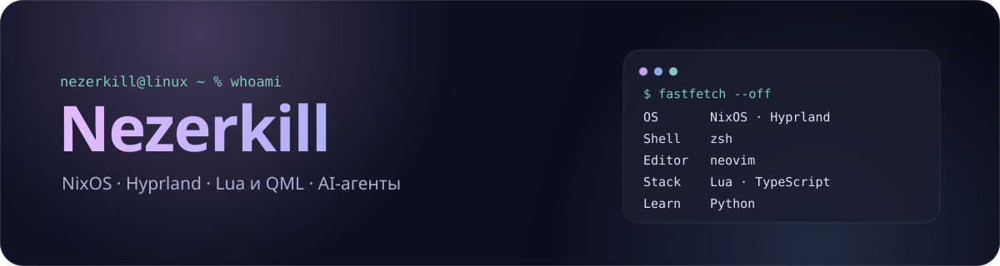
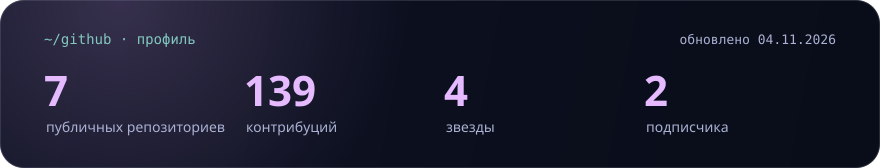

  

 

**Вайбкодер.** Разрабатываю собственные проекты с AI-агентами: Linux-окружение, плагины для терминала и панели, инструменты вокруг OpenCode.

**Направления**

- **Exteraless** — форк Telegram Desktop для Linux: сборка, конфигурация, поддержка.
- **opencode-usage** — плагин для OpenCode с лимитами подписки и таймерами сброса в TUI.
- **Noctalia** — плагины для панели, включая управление наушниками Honor Choice.

### Стек

  
  
  
  
  
  
   
  
  
  
  
   
  

### Проекты

| Проект | Описание |
| :-- | :-- |
| **[exteraless-desktop](https://github.com/Nezerkill/exteraless-desktop)** | Форк Telegram Desktop для Linux |
| **[opencode-usage](https://github.com/Nezerkill/opencode-usage)** | Лимиты OpenCode Go и таймеры сброса в TUI |
| **[dotfiles](https://github.com/Nezerkill/dotfiles)** | Конфигурация Hyprland на Lua |
| **[honor-earbuds](https://github.com/Nezerkill/honor-earbuds)** | Плагин Noctalia V5 для наушников Honor Choice |
| **[nezer](https://github.com/Nezerkill/nezer)** | Личная bio-страница |

### Статистика

  

  <a href="https://nezerkill.github.io/nezer/">bio</a> · <a href="https://github.com/Nezerkill">github</a>

